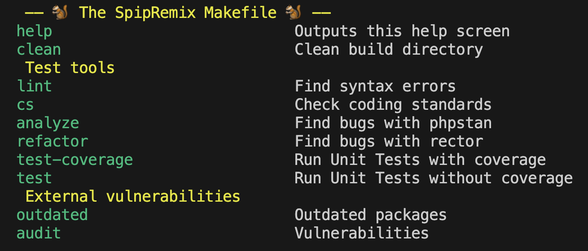

# Friends of SPIP

## Build

```bash
./build.sh
./build.sh apache
./build.sh fpm
```

## Usage

See [Versions](https://hub.docker.com/r/spip/tools/tags)

`spip/tools` provides PHP, its extensions, Composer, `make`, `jq` and `parallel-lint`.
The other QA tools (phpstan, ecs, rector, phpunit, php-cs-fixer) **come from the project**:
the Makefile runs `composer install`, then uses `vendor/bin/<tool>`, so the versions are the ones
of the project (add the tools, or `spip-league/qa-tools`, to its `require-dev`).

- `lint` lints the files listed in `phplint.lst`, or the whole project (except `vendor`, `lang`, `node_modules`, `build`)
  if there is a `composer.json`. `ecs.php` and `rector.php` are not linted, as these tools may run on a newer PHP.
- `test-coverage` uses `pcov` (not available on PHP 8.6 yet). `pcov` is disabled by default (`pcov.enabled=0`),
  the Makefile enables it only for the coverage.
- `audit` fails when Composer reports a vulnerability.
- Reports are written in `build/`: `phplint.json`, `phpstan.json` (GitLab code quality), `junit.xml`, `cobertura.xml`,
  `gl-audit.json`, `gl-outdated.json`. `ecs` and `rector` only output to the console (no GitLab format anymore).

Locally:

```bash
docker run --rm -v $(pwd):/build/app spip/tools:<version> # Display the commands list
```

Example `docker run --rm -v $(pwd):/build/app spip/tools:8.2`:



```bash
docker run --rm -v $(pwd):/build/app spip/tools:<version> <[command ...]>
```

Example `docker run --rm -v $(pwd):/build/app spip/tools:8.5 clean lint analyze`:

```txt
Looking for PHP syntax errors ...
0 error(s).
Looking for bugs with phpstan ...
Note: Using configuration file /build/app/phpstan.neon.dist.
```

Local Shortcut

`alias spip-tools='docker run --rm -v $(pwd):/build/app spip/tools'`

```bash
spip-tools clean test
```

in a `.gitlab-ci.yml`:

```yml
my-job:
    stage: my-stage
    image:
        name: spip/tools:<version>
        entrypoint:
        - "/bin/ash"
        - "-c"
    script:
        - make -f /Makefile <[command ...]>
    artifacts:
        - <build/[file ...]>
```

Custom your own image:

```Dockerfile
FROM spip/tools:<version>
ENV COMPOSER_AUTH="{\"github-oauth\": {\"github.com\": \"xxxxx\"}, \"gitlab-token\": {\"gitlab.my.org\":\"xxxxx\"}}"
COPY <my-tool>.make /build/makefiles
RUN apk --no-cache add openssh git && \
    ssh-keyscan gitlab.my.org > /build/.ssh/known_host && \
    composer config --global gitlab-domains gitlab.my.org
```

```bash
docker run \
    --rm \
    -e SSH_AUTH_SOCK=/ssh-agent \
    -v $(pwd):/build/app \
    -v $SSH_AUTH_SOCK:/ssh-agent \
    your/image:<version> <command>
```

## TODO

### V2

- `phplint.exclude.lst` optional
  - `parallel-lint --exclude src/templates --exclude tests/fixtures src tests`
  - `parallel-lint --exclude "$(cat phplint.exclude.lst)"> $(cat phplint.lst)`
- include /makefiles/*.make
- deptrac
- template config files + check command
- src files hash(js turbo like)

### V3

- "spip-cli"
- "checkout"

### Notes

Since PHP8.6, opcache is always present, pear is no more present.

The official `php:8.6-cli-alpine` image is built with ZTS (`PHP_ZTS=1`), unlike PHP 8.5 and earlier (NTS).

PECL extensions of the tools image (`pcov`) are installed with [PIE](https://github.com/php/pie) (PHP 8.1+),
with `install-php-extensions` for older PHP versions. `xdebug` is only provided in the web images (apache, fpm).

### Zip

PHP7.4

- Zip version => 1.15.6
- Libzip headers version => 1.8.0

PHP8.5

- Zip version => 1.22.8
- Libzip version => 1.11.4
- BZIP2 compression => Yes
- XZ compression => Yes
- ZSTD compression => Yes
- AES-128 encryption => Yes
- AES-192 encryption => Yes
- AES-256 encryption => Yes
